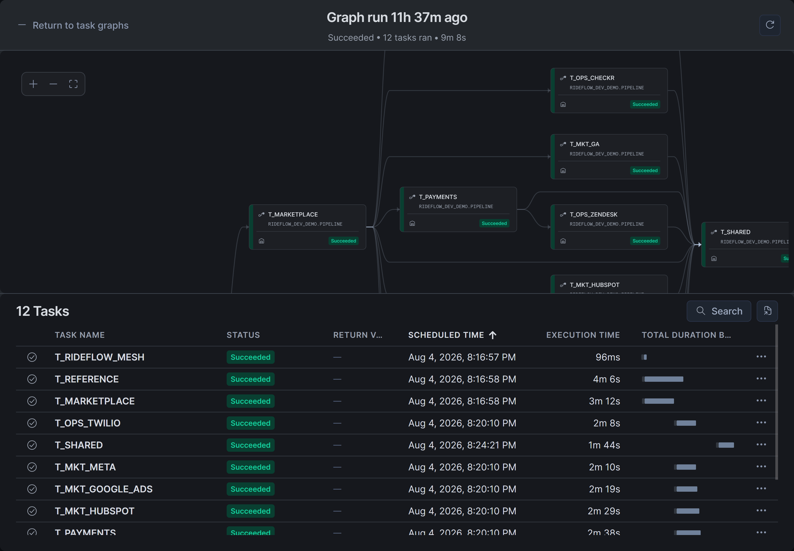
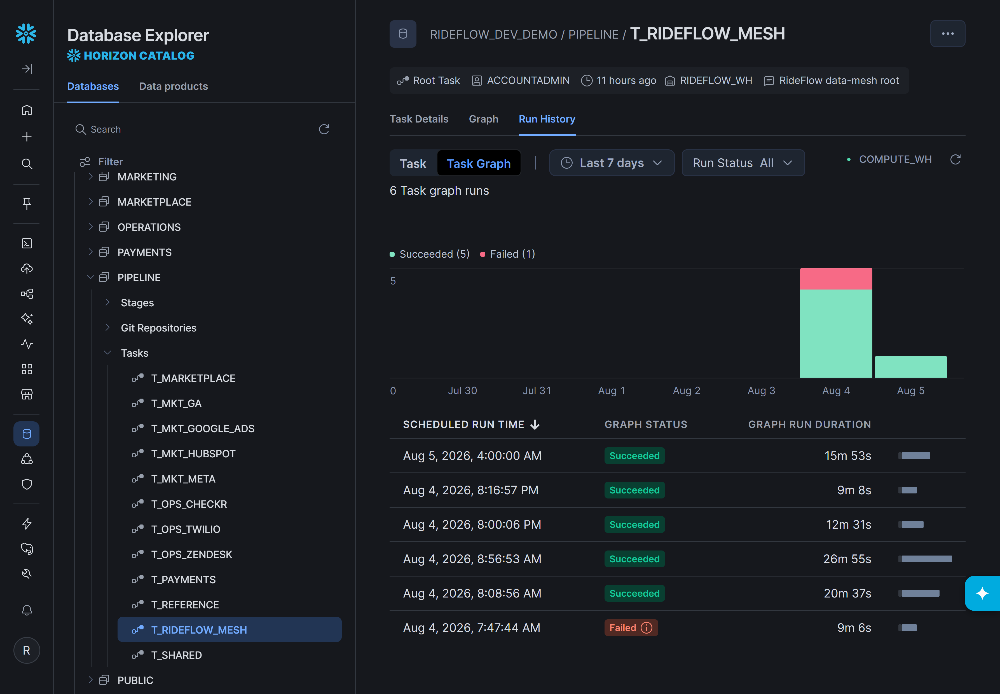

# RideFlow: a governed data mesh on Snowflake

**Build a decentralised Snowflake lakehouse with shared governance.**

Businesses need data they can trust, but ingestion, transformation and quality checks are often implemented differently across teams. Ownership is unclear, governance is inconsistent, and every new source adds more custom code to maintain. **LakeLogic Core standardises ingestion, transformation, validation and materialisation through executable data contracts**, giving domain teams a consistent way to deliver governed data products.

RideFlow demonstrates this on Snowflake: CSV and JSON exports alongside PDFs, images and Word documents, processed by Snowflake Notebooks and scheduled as Snowflake Tasks.

This synthetic reference project uses **Snowflake Notebooks on a compute pool, Tasks, internal stages and a Git repository object**, with **158 contracts across seven domains** and Bronze, Silver and Gold layers. The contracts are the same ones that run in the [Databricks reference project](https://github.com/LakeLogic/lakelogic-rideflow-databricks-governed-lakehouse); only the platform layer differs.

> RideFlow is a fictional business using synthetic data. This is a community reference from the LakeLogic team, not an official Snowflake product.

## Architecture

Domains maintain their own contract trees and publish products in separate databases (`RIDEFLOW_DEV_<DOMAIN>`). Shared Gold products consume outputs across domain boundaries; reusable notebooks and deployment tooling provide the common platform.

**Why this is a mesh pattern:** domain-local definitions, consumer-facing products, reusable platform execution and shared governance conventions. Database separation and declared owners do not automatically establish team permissions; grant roles on each domain database explicitly.

Domains: Marketplace, Payments, Operations, Marketing, Business, Reference and Shared. The contract tree is authoritative. [Explore the architecture](docs/architecture.md)

| Path | Contents |
| --- | --- |
| `contracts/` | Domain and system registries plus 158 contracts, identical to Databricks |
| `platform/snowflake/notebooks/` | Setup, pipeline driver, test data, SLO checks, maintenance, erasure and retention |
| `platform/snowflake/tasks/` | One task graph per system, the mesh orchestrator and admin, monitor, privacy and test tasks |
| `platform/snowflake/sql/` | One-time bootstrap (database, warehouse, Git repository) and setup |
| `platform/snowflake/deploy/` | Deploys everything from the Git repository; object names per environment |

## What you can learn

| Your focus | What to inspect |
| --- | --- |
| Architecture | Domain boundaries, inherited settings and cross-domain dependencies |
| Engineering | Contract-driven ingestion, transformations, incremental processing and orchestration |
| Analytics | Gold facts, dimensions and a shared city/day marketplace-health product |
| Governance | Ownership, quality rules, privacy operations, service expectations and their evidence |
| Platform delivery | Snowflake Notebooks and Tasks deployed from Git, and repository validation |

## Run the example

Use an isolated demo account or database. You need a Snowflake role that can create databases, a warehouse, a compute pool and tasks, plus Python with `snowflake-connector-python`.

**Before deploying:** review the [deployment target](platform/snowflake/deploy/deployment_targets.json) and copy [`.env.example`](platform/snowflake/deploy/.env.example) to `.env` with your connection. Warehouse and compute-pool usage incurs costs; synthetic inputs need no live source-system credentials.

**Runs stay in your account.** Inspect run metadata and quality results in each domain database's `LAKELOGIC` schema. Sending run metadata to LakeLogic Platform is not yet available on Snowflake.

```bash
python platform/snowflake/deploy/deploy_project.py --env dev --run
```

Without `--run`, it deploys only; then execute the **`pl_data_00_mesh_orchestrator`** task. The deploy also resumes that task on its daily schedule (03:00 UTC), so suspend it when you finish with the demo.



*RideFlow reference project · synthetic data. A mesh run in Snowsight.*

**Notebooks need LakeLogic.** They install it from PyPI through an external access integration (`SNOWFLAKE_PYPI_INTEGRATION` in `.env`). Without one, they install from wheels staged in the `"pipeline"."wheels"` stage.

**Test without live sources.** The `pl_test_synthetic_seed` task generates synthetic inputs from Bronze contracts, including PDFs, images and Word documents. Synthetic rows carry a `_synthetic` marker through Silver and Gold.

**Check before rerunning:** some products overwrite their outputs on every run. Do not point the demo at production tables.

## Follow one data product

**How do trip demand, completion and revenue vary by city and day?**

Follow Marketplace requests and completed trips, join Payments charges, and inspect the Shared marketplace-health mart. Its grain is one row per `(kpi_date, city_code)`. Inspect accepted and rejected rows alongside run status, not just whether the task finished.

## Evidence and limitations



*RideFlow reference project · synthetic data. Use your deployment's tables and logs to verify the revision you run.*

- Configured row failures may enter quarantine; dataset gates and execution errors can stop a run.
- Contract definitions and CI checks are distinct from successful Snowflake execution. Use dated runs and output checks for the exact revision deployed.
- Synthetic tests do not establish production performance, security or business correctness. Retention and erasure tasks do not establish end-to-end GDPR compliance.
- Review permissions, realistic SLOs, recovery and operating costs before production use.

## Explore further

[Contract specification](https://github.com/LakeLogic/open-lakehouse-contract) | [LakeLogic Core runtime](https://github.com/LakeLogic/LakeLogic) | [Databricks reference project](https://github.com/LakeLogic/lakelogic-rideflow-databricks-governed-lakehouse) | [Fabric reference project](https://github.com/LakeLogic/lakelogic-rideflow-microsoft-fabric-governed-lakehouse) | [Architecture reference](docs/architecture.md)

<sub>Platform layer generated by LakeLogic Lakehouse Studio from the Databricks reference contracts.</sub>
