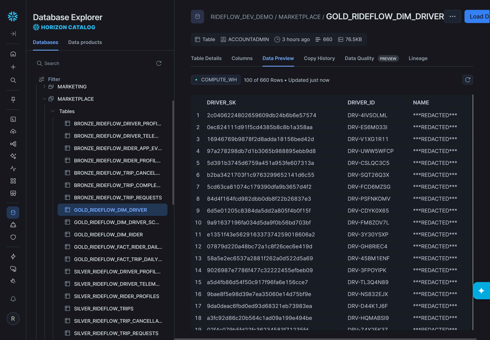
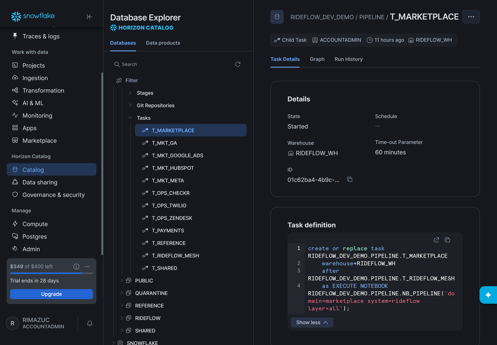

# Multi-Domain Lakehouse on Snowflake — a Governed Data Mesh Implementation

*One Snowflake lakehouse, many domain-owned data products — implementing the principles of a
**data mesh** (domain ownership, data as a product, a self-service platform, and federated
governance) with data contracts, quarantine and quality gates.*

> **Let every team own its data — without losing control of quality, PII or trust.**
> This is a working blueprint for a governed data mesh on Snowflake: domain teams ship their own
> data products, while one shared layer applies schema, quality, lineage and PII rules across all
> of them — and emits the run evidence to show it. The native path executes through Snowflake
> Notebooks and a Snowflake Task DAG, without an external orchestrator.

A working reference implementation on Snowflake, powered by
[LakeLogic](https://pypi.org/project/lakelogic/): **six domains own their Bronze→Silver→Gold data
products** in one lakehouse, all sharing a single contract-driven layer for quality, quarantine,
lineage and dependencies. It runs natively as a Snowflake Task DAG — no external orchestrator.

The example is **RideFlow**, a fictional ride-hailing business (all data synthetic, generated
FK-consistent from the contracts):

```text
RideFlow · one Snowflake lakehouse · 6 domains · 11 source systems
Every domain runs the same medallion — Bronze (raw, all-string, schema-flexible) → Silver (typed, cleaned, transformed, validated) → Gold (products)
│
├── Marketplace   (rideflow)                          ← shown expanded as the example
│   ├── Bronze   raw · all-string · schema-flexible (evolves, keeps everything)
│   │     driver_profiles · rider_profiles · driver_telemetry · rider_app_events
│   │     trip_requests · trip_completed · trip_cancellations
│   ├── Silver   typed, cleaned, deduped, transformed, validated
│   │     driver_profiles · rider_profiles · trips (joined) · trip_requests
│   │     driver_telemetry · rider_app_events
│   └── Gold   business products
│         dim_driver · dim_driver_scorecard · dim_rider
│         fact_trip_daily_kpis · fact_rider_daily_metrics · fact_surge_pricing_inference
│
├── Payments     (stripe)        →  Bronze → Silver → Gold   ·  charges, payouts
├── Operations   (checkr · twilio · zendesk)   →  Bronze → Silver → Gold
├── Marketing    (google_ads · google_analytics · hubspot · meta_ads)   →  Bronze → Silver → Gold
├── Reference    (internal)      →  Bronze → Silver → Gold   ·  cities, fx rates
└── Shared       (cross-domain marts)   →  Gold   ·  products that join every domain
```

Each domain owns its contracts and products; the platform gives them shared quality, governance and
dependency controls. **One command deploys and runs the whole thing** — see
[Deploy & run the pipelines](#deploy--run-the-pipelines).

> A community reference from the LakeLogic team, not an official Snowflake product.

## What this proves

- **Domain ownership** — teams own their contracts and data products.
- **Shared controls** — schema checks, row rules, dataset gates, SLO checks and
  dependency-aware execution use common machinery.
- **Explained quarantine** — failing rows are retained with the rule and reason that
  rejected them, never silently dropped.
- **Quality gates** — a dataset-level `min_good_ratio` gate can stop an unsafe run.
- **Cross-domain products** — declared dependencies connect products across teams.

## See it in action

Six teams, eleven source systems, one set of rules — executed through **Snowflake Notebooks and a
Snowflake Task DAG**, with no external orchestrator and no infrastructure to babysit.

🟢 **The whole company's data estate, rebuilt on one schedule.** Every domain's Bronze→Silver→Gold
products run as a single dependency-aware Task Graph — here, all 11 systems green in ~9 minutes.


🔒 **Auditable governance evidence, by construction.** Selected Gold dimensions demonstrate
SCD Type 2 history and row-level lineage back to source, and PII columns are masked by contract —
names, emails and phones land `***REDACTED***` unless a policy says otherwise.



🧩 **Every domain, the same contract-driven pattern.** Each product is one declarative step
(`domain / system / layer`) — once source data lands, teams add processing by defining a contract,
not by writing another medallion pipeline.



📈 **Trustworthy by default, observable end-to-end.** Every run and its data-quality summary is
tracked natively — so a failed load is visible immediately, not discovered in a dashboard weeks later.


## How it maps to Snowflake

Snowflake is both the **compute and the storage** — there is no object-store file
medallion. LakeLogic's `snowflake` engine runs every contract **as SQL inside
Snowflake** via `snowflake-connector-python`, driven by a small Python client.

| Data-mesh need | Snowflake implementation |
| --- | --- |
| Catalog | A **database** (e.g. `RIDEFLOW_DEV_DEMO`) |
| Domain boundary | A **schema** per domain (`MARKETPLACE`, `MARKETING`, …) |
| Bronze / Silver / Gold | **Tables** in the domain schema |
| Landing zone | A `LANDING` schema of tables (+ per-domain stage "volumes") |
| Rejected rows | A shared `QUARANTINE` schema |
| Compute | A **warehouse** (`RIDEFLOW_WH`, XSMALL, auto-suspend) |

Bronze reads a **table** source: LakeLogic's `snowflake` engine resolves each contract's
`source` to a named table and runs the contract as SQL against it, so the deploy generates
FK-consistent synthetic data and materializes `LANDING.<system>_<entity>` before the
medallion runs — either directly (`write_pandas`), or (with `--via-stage`) by `PUT`-ing
partitioned files into a per-domain stage and `COPY INTO`, mirroring a real ingestion drop
zone.

> Snowflake *can* read staged files directly — `SELECT … FROM @stage`, **external tables**,
> or **directory tables** — so Bronze could read the stage without a physical `COPY INTO`
> (e.g. via an external table / a view over the stage). That's an engine enhancement: the
> `snowflake` engine's contract `source` is table-based today, not stage/file-based.

## Prerequisites

- Python 3.9+ and `pip install "snowflake-connector-python[pandas]" "lakelogic>=1.41.0" pyyaml`.
- A Snowflake account and a role that can **create a database and a warehouse**.
  A free [Snowflake trial](https://signup.snowflake.com/) works and gives you an
  account plus `ACCOUNTADMIN`.

## Configure your connection

Copy the template and fill it in (the file is gitignored):

```bash
cp deploy/.env.example deploy/.env
```

```ini
SNOWFLAKE_ACCOUNT=ORGNAME-ACCOUNTNAME
SNOWFLAKE_USER=your_user
SNOWFLAKE_PASSWORD=your_password
SNOWFLAKE_ROLE=ACCOUNTADMIN
SNOWFLAKE_WAREHOUSE=RIDEFLOW_WH
SNOWFLAKE_DATABASE=RIDEFLOW_DEV_DEMO
```

### Where each value comes from

Run this once in a **Snowsight worksheet** — it prints most of what you need:

```sql
SELECT CURRENT_ORGANIZATION_NAME()  AS org,
       CURRENT_ACCOUNT_NAME()       AS account,
       CURRENT_USER()               AS "user",
       CURRENT_ROLE()               AS role;
```

- **`SNOWFLAKE_ACCOUNT`** — the **account identifier**, in the form
  `ORGNAME-ACCOUNTNAME` (join the two columns above with a hyphen, e.g.
  `MYORG-XY12345`).
  - Or in Snowsight: click your **account name (bottom-left)** → hover the account →
    **Copy account identifier**.
  - Or read it from your Snowsight URL `https://app.snowflake.com/<org>/<account>/…`
    → use `<org>-<account>`.
  - The legacy **account locator** (e.g. `xy12345.eu-west-1.aws`) also works if that's
    what you have. Do **not** include `.snowflakecomputing.com`.
- **`SNOWFLAKE_USER`** — your login name (the `CURRENT_USER()` value, or the username
  you sign in with).
- **`SNOWFLAKE_PASSWORD`** — your account password.
  - If your account **enforces MFA**, password auth will prompt/fail non-interactively.
    Use a **key-pair** instead (see below) or a dedicated service user without MFA.
- **`SNOWFLAKE_ROLE`** — a role allowed to `CREATE DATABASE` and `CREATE WAREHOUSE`.
  `ACCOUNTADMIN` or `SYSADMIN` work on a trial. List yours with:
  ```sql
  SHOW GRANTS;      -- roles granted to the current user
  ```
  To use a custom role, grant it once as an admin:
  ```sql
  GRANT CREATE DATABASE ON ACCOUNT TO ROLE MY_ROLE;
  GRANT CREATE WAREHOUSE ON ACCOUNT TO ROLE MY_ROLE;
  ```
- **`SNOWFLAKE_WAREHOUSE`** — an existing warehouse, or a **new name** the deploy will
  create (XSMALL, `AUTO_SUSPEND=60s`). List existing ones with `SHOW WAREHOUSES;`.
- **`SNOWFLAKE_DATABASE`** — the database the demo creates. Pick any name you like
  (default `RIDEFLOW_DEV_DEMO`). The deploy runs `CREATE DATABASE IF NOT EXISTS`.

#### Optional: key-pair auth (recommended for MFA accounts / automation)

Generate a key, register the public key on your user, and set
`SNOWFLAKE_PRIVATE_KEY_PATH` instead of `SNOWFLAKE_PASSWORD`:

```bash
openssl genrsa 2048 | openssl pkcs8 -topk8 -inform PEM -out rsa_key.p8 -nocrypt
openssl rsa -in rsa_key.p8 -pubout -out rsa_key.pub
```
```sql
ALTER USER your_user SET RSA_PUBLIC_KEY='<contents of rsa_key.pub without header/footer>';
```
Then in `.env`: `SNOWFLAKE_PRIVATE_KEY_PATH=/path/to/rsa_key.p8` (and leave the
password blank).

## Deploy & run the pipelines

Two ways to run the mesh — **pick one**. Both use the same contracts and the same
`runtime/` code; they differ only in *where* the medallion runs.

| | Path A — local client | Path B — native Snowflake Project |
|---|---|---|
| Where it runs | your machine drives Snowflake SQL | inside Snowflake (Notebooks + Task DAG) |
| Needs | Python + `.env` | a compute pool (public repo — no GitHub credentials) |
| Best for | fastest way to see it work | scheduled, in-Snowsight, self-serve from GitHub |
| Command | `python deploy/deploy.py` | run `sql/bootstrap.sql`, then `EXECUTE TASK … T_RIDEFLOW_MESH` |

### Path A — local client (fastest)

Runs the whole medallion from your machine — LakeLogic's `snowflake` engine executes the
SQL in Snowflake. No compute pool, no Git, no notebooks.

```bash
# Full mesh — all 11 systems across 6 domains, in FK order
# (creates DB/WH/schemas, generates + loads landing, runs Bronze→Silver→Gold everywhere)
python deploy/deploy.py

# Just one system, end-to-end
python deploy/deploy.py --domain payments/stripe

# Provision only (schemas, no data)
python deploy/deploy.py --setup-only

# Land via the stage "volume" (PUT + COPY INTO, y_/m_/d_/h_ partitions) instead of direct load
python deploy/deploy.py --domain marketplace/rideflow --via-stage
```

### Path B — native Snowflake Project (in-Snowflake, scheduled)

Runs the same medallion **inside Snowflake** as one parameterized Notebook orchestrated by
a **Task DAG**, deployable straight from this Git repo. Full setup is in
[Native Snowflake Project](#native-snowflake-project-notebooks--contracts--tasks) below.
Once deployed, run the whole mesh on demand:

```sql
EXECUTE TASK RIDEFLOW_DEV_DEMO.PIPELINE.T_RIDEFLOW_MESH;   -- runs all 11 systems in FK order
```
(It also fires nightly on a schedule.)

### Verify (either path)

```sql
USE DATABASE RIDEFLOW_DEV_DEMO;
SHOW SCHEMAS;   -- LANDING, QUARANTINE, PIPELINE + one per domain: MARKETPLACE, MARKETING, OPERATIONS, PAYMENTS, REFERENCE, SHARED

SELECT * FROM MARKETPLACE.GOLD_RIDEFLOW_FACT_TRIP_DAILY_KPIS;   -- a domain data product
SELECT * FROM SHARED.GOLD_SHARED_FACT_REVENUE_DAILY;           -- a cross-domain mart (reads many domains)
SHOW TABLES IN SCHEMA QUARANTINE;                              -- rejected rows + the rule/reason that rejected them
```

## Repository layout

```text
domains_rideflow/          Domain-owned contract trees (portable, engine-agnostic)
  <domain>/<system>/contracts/{bronze,silver,gold}/
runtime/                   Shared LakeLogic-on-Snowflake runtime (used by deploy AND notebooks)
  medallion.py             run_layer(): run + persist one medallion layer on a connection
  landing.py               generate + load LANDING (direct, or PUT+COPY INTO a stage volume)
  testdata.py              Per-domain data generators (conn-aware, cross-domain FK-consistent)
notebooks/pipeline_driver.ipynb  One parameterized driver (domain/system/layer via key=value params)
tasks/tasks.sql            Full-mesh Task DAG snapshot — max parallelism (natural FK DAG); deploy generates per --mesh-max-parallel
wheelhouse/                LakeLogic (fixed) + pure-python dep wheels (trial-safe notebook install)
sql/bootstrap.sql          One-time: create DB/WH/Git repo (public, no creds), then run setup.sql from git
sql/setup.sql              Flesh out the whole project from the repo (compute pool, wheels, notebooks, tasks)
deploy/deploy.py           Local client: provision + landing + run medallion (fastest path)
deploy/deploy_project.py   Deploy the native Snowflake Project from Python (Git + Notebooks + Tasks)
deploy/.env.example        Connection + Project template
docs/iceberg-roadmap.md    Making it an open lakehouse (Iceberg via Horizon; native vs external)
docs/external-storage-setup.md  External stage/table on AWS S3 / Azure / GCP (files as the source)
```

`domains_rideflow/` is shared verbatim with the LakeLogic Databricks and Fabric
reference repos — the contracts are portable. Only the deploy/runtime layer differs
per platform.

## Native Snowflake Project (Notebooks + Contracts + Tasks)

Beyond the local client, the whole medallion can run **inside Snowflake** as a
**Git-connected Workspace** so every component is visible in Snowsight:

| Component | Where it shows up |
| --- | --- |
| Contracts (`domains_rideflow/`) + notebooks + tasks | **Projects → Workspaces** (the Git repo) |
| LakeLogic driver notebook | **Projects → Notebooks** — one `NB_PIPELINE`, parameterized by layer |
| Orchestration + run history | **Monitoring → Task History / Task Graph** |
| Data products / quarantine | **Databases →** `RIDEFLOW_DEV_DEMO` schemas |

**One parameterized driver, not one notebook per domain×layer.** A single `NB_PIPELINE`
notebook runs any `domain / system / layer`, chosen by parameters a Task passes as a
`key=value` string — `EXECUTE NOTEBOOK NB_PIPELINE('domain=marketplace system=rideflow
layer=all')` — read from `sys.argv` (the Snowflake analogue of Databricks/Fabric widget
parameters). To run it interactively, edit the defaults in the notebook's top
**parameters cell** and Run.

The **Task DAG** runs at **maximum parallelism by default** — a **natural FK DAG** where each
system depends only on its real cross-domain parents (multi-predecessor `AFTER`), so once
`marketplace` finishes, all seven downstream systems fan out at once
(`marketplace, reference` → `payments, checkr, twilio, google_ads, google_analytics, hubspot,
meta_ads` → `zendesk` → `shared`), each calling `NB_PIPELINE(domain, system, layer=all)`.
The deploy **generates** the DAG and **auto-sizes the compute pool** to the peak width
(`MAX_NODES=8`); the wide fan-out that previously threw *"unschedulable in full compute pool"*
was purely a pool-sizing issue. **Validated on the trial: the whole 11-system mesh runs green
in ~9 minutes.** Foreign keys stay consistent (a downstream system reads real upstream ids).

Concurrency is a knob — `deploy_project.py --mesh-max-parallel N`: **`0` (default) = max**,
`2` = FK-ordered waves of 2 (tighter node footprint, ~65 min), `1` = fully sequential. The notebooks run the **same `runtime/` code the local deploy uses**,
on the notebook's own Snowpark session
(`SnowflakeAdapter.set_shared_connection(session.connection)`) — no password in the
notebook — so the whole mesh runs **inside Snowflake** with native run history.

### Deploy from GitHub (self-serve, no laptop) — recommended

Snowflake reads the repo directly and fleshes out everything. In a Snowsight worksheet:

1. Open **`sql/bootstrap.sql`** and run it — **no GitHub credentials required** (Snowflake
   clones this public repo anonymously). It creates the database, warehouse and `GIT REPOSITORY`,
   then calls:
   ```sql
   EXECUTE IMMEDIATE FROM @RIDEFLOW_DEV_DEMO.PIPELINE.RIDEFLOW_REPO/branches/main/sql/setup.sql;
   ```
2. `setup.sql` (run from the repo) creates the schemas, compute pool, **stages the
   LakeLogic wheelhouse**, creates the `NB_PIPELINE` Notebook + the full-mesh Task DAG,
   and kicks off a run.
3. Watch **Monitoring → Task History** (or the `T_RIDEFLOW_MESH` **Graph** tab).

Forked the repo **privately**? Add a credential secret and reference it from the API
integration + Git repository — see the commented "private fork" block at the bottom of
`sql/bootstrap.sql`.

**Or from Python** (same result, parameterized via `deploy/.env`):
```bash
# public repo — no GitHub credentials needed; the Snowflake connection comes from deploy/.env.
# (Only a PRIVATE fork needs GITHUB_USER + GITHUB_PAT; defaults to the public repo otherwise.)
python deploy/deploy_project.py --run
```

### Run the pipelines (once the Project is deployed)

```sql
-- Whole mesh, on demand (or wait for the nightly schedule):
EXECUTE TASK RIDEFLOW_DEV_DEMO.PIPELINE.T_RIDEFLOW_MESH;

-- Just one system / layer, headless:
EXECUTE NOTEBOOK RIDEFLOW_DEV_DEMO.PIPELINE.NB_PIPELINE('domain=payments system=stripe layer=all');
```

- **Interactively:** open **Projects → Notebooks → `NB_PIPELINE`**, edit the top
  **parameters cell** (`domain=…, system=…, layer=…`), and **Run all**.
- **Watch it:** **Monitoring → Task History** → the `T_RIDEFLOW_MESH` **Graph** tab shows
  each system node succeed in order.

### How the Notebooks get LakeLogic

The medallion needs **`lakelogic>=1.41.0`** (the Snowflake-engine fixes:
`set_shared_connection` + `TRY_CAST`→`TO_VARCHAR`). How it installs depends on how the
notebook runs:

- **Headless (Task DAG / `EXECUTE NOTEBOOK`)** — Snowflake's internal PyPI mirror is **not**
  available in headless runs, so notebooks install from a **wheelhouse staged in Snowflake**
  (`@PIPELINE.WHEELS`, populated from `wheelhouse/`) with `pip --no-index`. This is the path
  the Task DAG uses. The container runtime already ships pandas/pydantic/pyyaml/snowflake-
  connector, so only `lakelogic` + `loguru` + `sqlglot` are staged.
- **Interactive (you click Run in the notebook)** — the internal PyPI mirror *is* available,
  so `pip install lakelogic>=1.41.0` works directly (no wheelhouse). Trial accounts can't use
  External Access Integrations, but the internal mirror is a separate, always-available proxy.

> Container-runtime Notebooks need compute pools (available on the trial). The local
> `deploy/deploy.py` path needs neither compute pools nor staged wheels — it runs the same
> `runtime/` code from your machine.

### How LANDING would be fed in production

The demo synthesizes LANDING. In production each source system maps to a Snowflake
ingestion path — e.g. **Snowflake Connector for Google Analytics** →
`marketing/google_analytics`, **ServiceNow connector**, or `COPY INTO` from an
S3/Azure/GCS/OneLake stage / Snowpipe Streaming — feeding the same `LANDING.<system>_<entity>`
tables the Bronze contracts read.

## Known limitations & notes

- **LakeLogic version + install:** the medallion needs the Snowflake-engine fixes in
  **`lakelogic>=1.41.0`**. The driver notebook's install cell already **prefers PyPI**
  (`pip install lakelogic>=1.41.0`) and only **falls back to the staged wheelhouse** when
  PyPI isn't reachable — which today is the case for **headless Task runs** (they can't reach
  Snowflake's internal PyPI mirror), so the wheelhouse (`wheelhouse/`, staged to
  `@PIPELINE.WHEELS`) is still required for the DAG. Interactive notebook runs already use
  PyPI. **To drop the wheelhouse entirely once PyPI is reachable everywhere for you**
  (e.g. a paid account with external access, or the mirror in headless runs): delete the
  `else` fallback in the driver's install cell and the wheelhouse staging in
  `deploy/deploy_project.py` + `sql/setup.sql`, then remove `wheelhouse/`.
- **Document/PDF extraction is out of scope** on the Snowflake SQL engine: the
  `operations/checkr` `driver_licences` contracts (which read PDF files via a glob source)
  were removed. `background_checks` — checkr's real product — runs fine. On Databricks/Fabric
  (Spark) the PDF-extraction path is supported.
- **Iceberg / open lakehouse** is a documented next step, not built here — see
  [`docs/iceberg-roadmap.md`](docs/iceberg-roadmap.md) and
  [`docs/external-storage-setup.md`](docs/external-storage-setup.md). The demo uses native
  Snowflake tables (the most common production choice); Iceberg is the open-format upgrade.
- **Scale:** data is synthetic and demo-sized (hundreds–thousands of rows per table) so the
  whole mesh runs in minutes on an XSMALL warehouse.

## Cost & teardown

The warehouse consumes credits only while queries run (auto-suspends after 60s); the
compute pool auto-suspends after 300s. To remove everything:

```sql
-- Account-level objects created by Path B (the native Project) — skip if you only ran Path A:
DROP COMPUTE POOL IF EXISTS RIDEFLOW_POOL;
DROP API INTEGRATION IF EXISTS GIT_API_RIDEFLOW;

-- Dropping the database also removes its schemas, tables, stages, Git repository,
-- the NB_PIPELINE notebook, tasks, and any GIT_PAT secret:
DROP DATABASE IF EXISTS RIDEFLOW_DEV_DEMO;
DROP WAREHOUSE IF EXISTS RIDEFLOW_WH;
```

## Take it further

```bash
pip install lakelogic
```

- **Documentation:** <https://lakelogic.github.io/LakeLogic/>
- **Package:** <https://pypi.org/project/lakelogic/>
